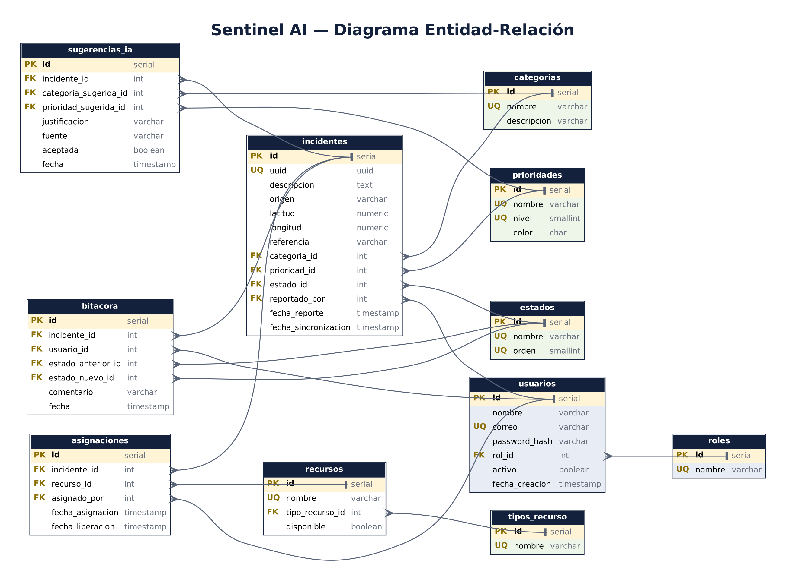

# Sentinel AI — Gestión inteligente de incidentes

Proyecto integrador de **Desarrollo Móvil + IA** · Universidad Dr. José Matías Delgado · Ciclo 02-2026.

Aplicación móvil para registrar incidentes de emergencia municipal por texto o voz, clasificarlos y priorizarlos con IA, geolocalizarlos, asignar recursos y dar seguimiento a su atención, incluso sin conexión.

## Estructura del repositorio

| Carpeta    | Contenido |
|------------|-----------|
| `android/` | App Android (Kotlin + Jetpack Compose) |
| `backend/` | API REST (Spring Boot 3 + PostgreSQL) |
| `sql/`     | Script del esquema, datos de prueba y DER |
| `docs/`    | Documentación y colección de Postman |

## Requisitos del backend

- Java 17 o superior
- Maven 3.9+ (o IntelliJ IDEA, que lo trae incluido)
- PostgreSQL 14 o superior

## Puesta en marcha

### 1. Crear la base de datos

```bash
psql -U postgres -c "CREATE DATABASE sentinel_ai;"
psql -U postgres -d sentinel_ai -f sql/01_schema.sql
psql -U postgres -d sentinel_ai -f sql/02_datos.sql
```

También se puede hacer desde pgAdmin: crear la base `sentinel_ai`, abrir la herramienta de consultas y ejecutar los dos scripts en orden.

### 2. Configurar la conexión

Por defecto el backend usa `localhost:5432`, usuario `postgres` y contraseña `postgres`. Para otros valores, definir variables de entorno:

```
DB_URL=jdbc:postgresql://localhost:5432/sentinel_ai
DB_USER=postgres
DB_PASSWORD=tu_contraseña
```

### 3. Ejecutar el backend

```bash
cd backend
mvn spring-boot:run
```

### 4. Probar

| Método | Endpoint | Descripción |
|--------|----------|-------------|
| GET | `/api/estado` | Estado de la API y de la conexión a PostgreSQL |
| GET | `/api/categorias` | Catálogo de categorías de incidentes |
| GET | `/api/categorias/{id}` | Una categoría (404 si no existe) |

La colección `docs/Sentinel_AI.postman_collection.json` incluye estas peticiones con pruebas automáticas.

Pruebas unitarias del backend:

```bash
cd backend
mvn test
```

## Usuarios de prueba

| Rol | Correo | Contraseña |
|-----|--------|------------|
| Supervisor | supervisor@sentinel.test | Sentinel2026 |
| Agente | agente@sentinel.test | Sentinel2026 |

Son datos ficticios para pruebas. El inicio de sesión con JWT se implementa en la Entrega 2.

## Modelo de datos

11 tablas: `roles`, `usuarios`, `categorias`, `prioridades`, `estados`, `tipos_recurso`, `recursos`, `incidentes`, `sugerencias_ia`, `asignaciones`, `bitacora`.



## Flujo de trabajo

- `main` protegida: los cambios entran solo por pull request.
- Una rama por funcionalidad: `feature/<nombre>`.
- Cada PR lo revisa el otro integrante.
